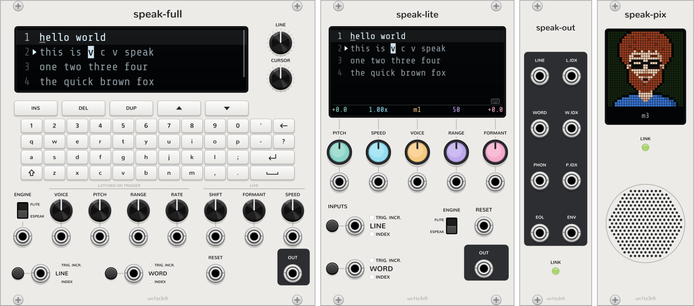

# Speak

A VCV Rack 2 text-to-speech synthesiser based on two venerable analytical speech synthesis engines which are instantly recognizable, adds the ability to modulate pitch and speed in real time using a combination of pre-rendering, sample caching and post-processing, to allow for singing-like effects. Trigger whole lines or word-by-word from an external clock.

Speak's source code includes vendored copies of the **eSpeak NG** and **Flite** speech engines.



Three modules:

- **Speak** (16HP): a 7-line full-width display edited from your computer keyboard (click it; a small keyboard
  glyph shows when it isn't focused), PITCH and SPEED knobs, and one VOICE CV across both engines. Its knob
  caps are colour-coded: PITCH teal, SPEED cyan, VOICE amber, RANGE purple, FORMANT pink, and the bottom of its
  screen shows each knob's current value (knob + CV) in the same colour, above the knob.
- **Speak Out** (6HP): Expander for **Speak** with some extra triggers, gates and cv outputs.
- **Speak Pix** (8HP): Expander for **Speak** which shows a pixel-art animated character lip-synched to **Speak**'s output.

## Speak

| Control | What it does |
|---|---|
| OLED | Numbered lines. Click to place the cursor and take keyboard focus. ▶ marks the line being spoken (its word inverted), ▷ the one the next trigger will speak (its word underlined). Without focus the view follows playback, keeping the queued line in sight and long lines scrolled to the current word. |
| ENGINE, VOICE, RANGE | eSpeak NG / Flite, the voice, intonation range. Latched on each trigger. On speak-full a gate on ENGINE's jack flips the switch and VOICE's CV spans the selected engine's voices. On speak-lite there is one VOICE CV: 0–10 V spans every voice of both engines (eSpeak's 103, then Flite's 5) and overrides the switch and knob. |
| FORMANT | Live formant shift, 1 V/oct. |
| LINE, WORD | Sequencing inputs; see below. Each has a small button beside it that acts as a trigger into that jack, and two lights showing how the jack reads its signal: **TRIG. INCR.** or **INDEX**. |
| RESET | Back to the first line and word. |

**LINE and WORD** Each jack reads either triggers or a steady index CV:

- Short pulses (back to 0 V within 20 ms) are triggers and step to the next line or word, wrapping at the end.
  Once a jack has seen one it fires on each rising edge with no added delay.
- A voltage that holds a level (or steps between levels) is an index: it selects a line or word, speaking it when
  the index changes. Its range is set in the menu (0–10 V spans them all by default; also 0–5, 0–1, ±5, ±10 V spans,
  or 1 V, 0.1 V or 1/12 V per step).

What gets spoken depends on what's patched:

| Patched | Result |
|---|---|
| LINE | Each step or selection speaks a whole line. |
| WORD | Each step or selection speaks one word, running through the whole text. Words are rendered on their own, so they come out whole and clear. |
| LINE and WORD | LINE picks the line without speaking; WORD speaks that line's words, wrapping within it. Put a bar clock into LINE and a beat clock into WORD for one lyric line per bar. When both edges land on the same beat, WORD waits 2 ms so LINE's step is applied first. |
| neither | The LINE and WORD buttons step as if triggers were patched; Ctrl+Enter on the display says the cursor's line. |

A jack starts over when it's re-patched, and the menu can force "triggers only" or "index CV only" if a signal
confuses it.

**Speak**'s PITCH knob (semitones, 1 V/oct) and SPEED knob (×0.25–×4, 1 V/oct) adjust engine parameters when silent. On a trigger, the
engine renders at the knob's value, snapped to a 2-semitone and quarter-octave grid with an in-memory cache so renders get reused; Pitch shifting with TD-PSOLA
adjusts the fine pitch, following the knob and CV live while the line plays. Beyond what the engine can do (eSpeak's pitch
spans about −7 to +9 semitones, Flite's ±12) PSOLA takes over entirely. If a trigger asks for a pitch or speed that
hasn't been rendered yet, it starts at once from the nearest one already in the cache and renders the exact one in
the background into the cache for next time.

In the context-menu: copy / replace / clear all lines through the system clipboard.

Keys with the display focused: arrows, Home/End, PgUp/PgDn, Enter splits a line, Shift+Enter inserts below,
Backspace/Delete join lines, Shift+Delete deletes the line, Alt+↑/↓ moves it, Ctrl+D duplicates, Ctrl+C / Ctrl+X copy /
cut the line, Ctrl+V pastes (multi-line text becomes lines), Ctrl+Enter speaks, Esc releases focus.

## Speak Outs

| Jack | |
|---|---|
| LINE / L.IDX | Gate while speaking (1 ms dip on retrigger) and the playing line's index. |
| WORD / W.IDX | Gate per word (1 ms dip between words) and the word's index within its line. |
| PHON (poly) | ch 1 any phoneme, ch 2 vowels only. |
| P.IDX (poly) | ch 1 phoneme position, ch 2 phoneme identity (ARPAbet id, 0.1 V/id). |
| EOL | Trigger when a line (or word) finishes on its own. |
| ENV | Speech envelope, 0–10 V. |

Index outputs are 0.1 V per step by default; its menu offers 1 V, 1/12 V (semitones) and "0–10 V spans the count"
(the inverse of the default INDEX range, so W.IDX can address another vcvspeak's lines).

## Speak Pix

Each voice has a different face, based on the voice names.

Phonemes map to nine mouth shapes (rest, M/B/P, A/I, E, O, U/W, F/V, L/TH, other consonants), each held for at least
50 ms so fast speech stays readable. The word being spoken is captioned under the face (the voice's name otherwise).
The face blinks, glances around while idle, looks ahead while talking, lifts its brows on some word starts, and falls
asleep when it isn't linked. It follows the voice by default; the menu can pin one of 64 fixed faces instead. The lower half of the panel is a
speaker grille.

`make faces` renders a contact sheet of every character.

## How it works

- `src/Tts.cpp`: one background thread serves every module instance (both engines keep global state, so all synthesis
  is serialised there). Triggers go to it through a lock-free queue; clips come back the same way, and finished clips are
  handed back to be freed off the audio thread. A 128 MB LRU cache is keyed by text + latched parameters, and while you
  aren't touching the knobs the worker pre-renders every line (or every word, in word mode) with the current settings,
  so a trigger normally costs well under a millisecond after its latch. On Speak a cache miss (e.g. an LFO on engine
  PITCH) costs one render, typically 20–60 ms; Compact answers from the nearest cached render instead.
- Rendered clips are trimmed of silence, normalised and analysed offline: a YIN f0 track, then pitch marks on the
  glottal peaks (jittered pseudo-marks through unvoiced sounds).
- `src/Psola.hpp`: the player overlap-adds Hann grains two periods long. Grain spacing follows PITCH, grain read rate
  follows FORMANT, and the analysis position advances at SPEED, so all three can move every sample.
- `src/Doc.hpp` is the editor model; `src/Widgets.hpp` the OLED, keycaps and endless encoders. Both Speak panels are
  one widget class driven by a layout table.
- `src/Face.hpp` is the face compositor (Rack-independent): procedural head, neck and shirt shapes, ASCII-art sprites
  for hair, beards, glasses and mouths, and an automatic silhouette outline pass.
- Speak sends a `SpeakLink` (phoneme, word, line, voice, envelope, caption) through Rack's double-buffered expander
  messages; every expander forwards it to its right, so they chain in any order.
- `src/Sequencer.hpp`: index ranges and the IN-jack classifier. `src/Tts.cpp` also holds the measured eSpeak/Flite
  pitch and rate curves that let Compact's merged knobs speak in semitones and tempo.
- `tools/panel.py` generates all eight panel SVGs (text as outlines) and `src/layout.hpp` from one set of layout tables.

## Building

```sh
make RACK_DIR=/path/to/Rack-SDK        # builds vendored eSpeak NG (CMake) + Flite (autotools), then the plugin
make RACK_DIR=... install              # or: dist
make RACK_DIR=... test                 # Linux: drives the module in real time and renders WAVs to build/
```

eSpeak's data (`res/espeak-ng-data`, ~31 MB, all languages) is compiled by a native host build, so cross-builds with
the VCV toolchain work too. Vendored snapshots are listed in `VENDOR.txt`.

## Licenses

Speak's license is GPL-3.0-or-later
eSpeak NG's license is GPL-3.0
Flite's license is BSD-style
